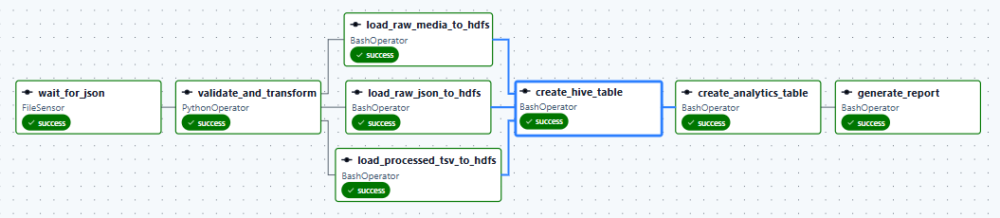

# Social Media ETL Pipeline

An end-to-end batch data pipeline that ingests social media posts (JSON), validates and transforms them, loads them into HDFS, and builds engagement analytics in Hive. The workflow is orchestrated with Apache Airflow.

**Tech stack:** Python, Apache Airflow 3, Hadoop HDFS, Apache Hive 3.1.3, HiveQL, Bash

## Pipeline



| Task | Operator | What it does |
|------|----------|--------------|
| `wait_for_json` | FileSensor | Waits for `data/incoming/social_media_posts.json` |
| `validate_and_transform` | PythonOperator | Validates the JSON and writes a tab-separated file |
| `load_raw_json_to_hdfs` | BashOperator | Uploads the original JSON to `/social_media/raw` |
| `load_raw_media_to_hdfs` | BashOperator | Uploads optional media files to `/social_media/media` |
| `load_processed_tsv_to_hdfs` | BashOperator | Uploads the TSV to `/social_media/processed` |
| `create_hive_table` | BashOperator | Creates database `social_media_dw` and an external table over the TSV |
| `create_analytics_table` | BashOperator | Builds per-user engagement analytics |
| `generate_report` | BashOperator | Writes `reports/social_media_analytics.txt` |

The three HDFS loads run in parallel after validation. Hive tasks start only when all three succeed.

Engagement score = `likes + 2 * comments + 3 * shares`

## Project structure

```text
social-media-etl-pipeline/
├── airflow/social_media_etl.py      # Airflow DAG
├── data/
│   ├── incoming/                    # sample input JSON
│   ├── media/                       # optional media files
│   └── processed/                   # generated TSV (git-ignored)
├── docs/                            # architecture + DAG screenshot
├── reports/                         # generated report (git-ignored)
├── scripts/validate_social_media.py # validation and transformation
├── sql/                             # HiveQL used by the DAG
├── .gitignore
└── README.md
```

## Input format

A JSON object with a top-level `posts` array. Each post needs `post_id`, `user`, `text`, `likes`, `comments`, `shares` and `timestamp` (ISO format). `media_file` is optional. Counters must be non-negative integers and `post_id` must be unique.

## Prerequisites

- Linux or WSL2, Java 8
- Hadoop with HDFS and YARN running (`start-dfs.sh`, `start-yarn.sh`, check with `jps`)
- Hive 3.1.3 at `/usr/local/hive`
- Apache Airflow 3 in a virtual environment

## How to run

**1. Test the validator on its own** (from the project root):

```bash
python3 scripts/validate_social_media.py \
  --input data/incoming/social_media_posts.json \
  --output data/processed/social_media_posts.tsv
```

It exits with a non-zero code and lists every problem if the JSON is invalid.

**2. Create the Airflow file connection** (once). The FileSensor uses `fs_default`:

```bash
airflow connections add fs_default --conn-type fs --conn-extra '{"path": "/"}'
```

**3. Copy the DAG and set the project path:**

```bash
cp airflow/social_media_etl.py ~/airflow/dags/
export SOCIAL_MEDIA_PROJECT_DIR=/absolute/path/to/social-media-etl-pipeline
```

Set the variable in the shell that starts Airflow (or edit the default in the DAG).

**4. Trigger `social_media_etl`** from the Airflow UI (`http://localhost:8080`). Check each task log and the report in `reports/social_media_analytics.txt`.

## Configuration

| Variable | Meaning | Default |
|----------|---------|---------|
| `SOCIAL_MEDIA_PROJECT_DIR` | Absolute path of this project | `~/social-media-etl-pipeline` |
| `SOCIAL_MEDIA_HDFS_DIR` | HDFS base directory | `/social_media` |
| `HADOOP_HOME` | Hadoop install | `/usr/local/hadoop` |
| `HIVE_HOME` | Hive install | `/usr/local/hive` |

## Known limitations and lessons learned

- **Hive runs on embedded Derby**, which allows one process at a time. While the DAG runs, do not start HiveServer2, `hive --service metastore` or another `hive` shell, or `create_hive_table` fails with `ERROR XSDB6: Another instance of Derby may have already booted the database`. For concurrent access, move the metastore to MySQL or PostgreSQL.
- **Use full paths for CLI tools in Airflow.** BashOperator does not load `~/.bashrc`, so a bare `hive` or `beeline` can resolve to the wrong binary (for example the one bundled with PySpark, which needs a newer Java). The DAG calls `/usr/local/hive/bin/hive` explicitly.
- This is a manually triggered batch pipeline, not real-time streaming.
